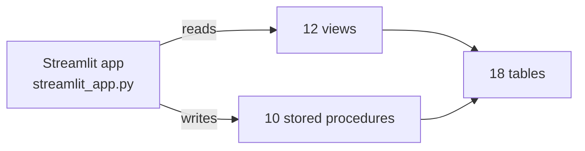
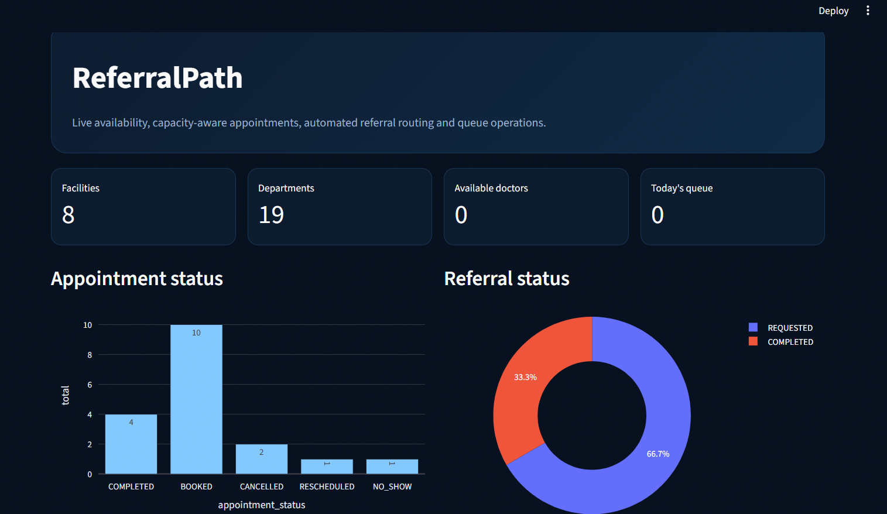
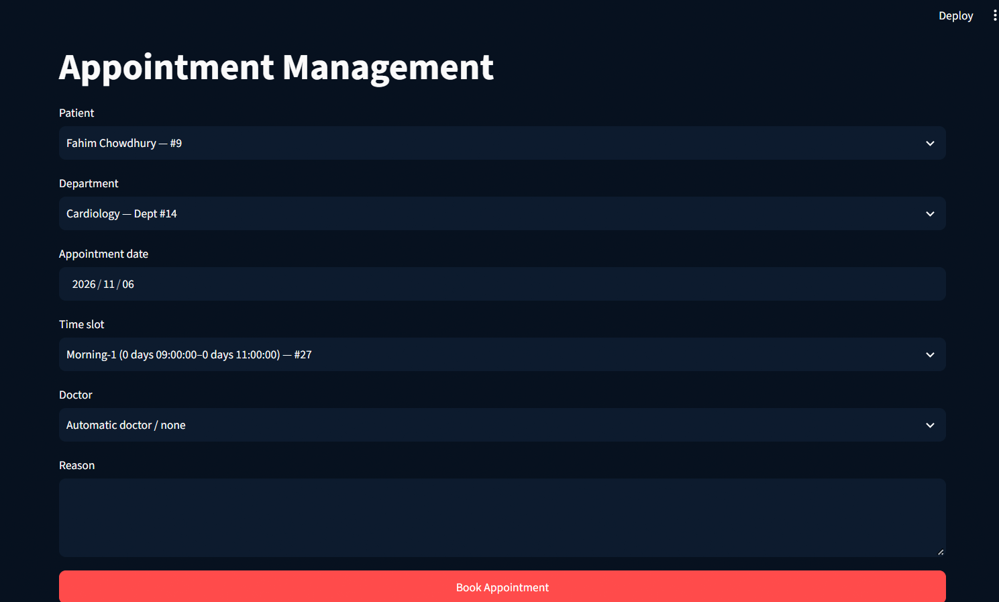
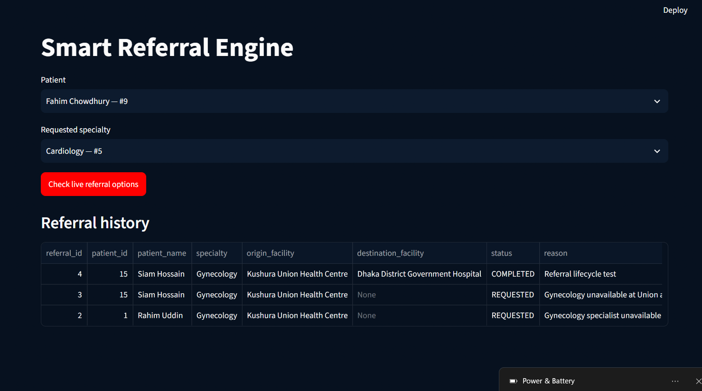
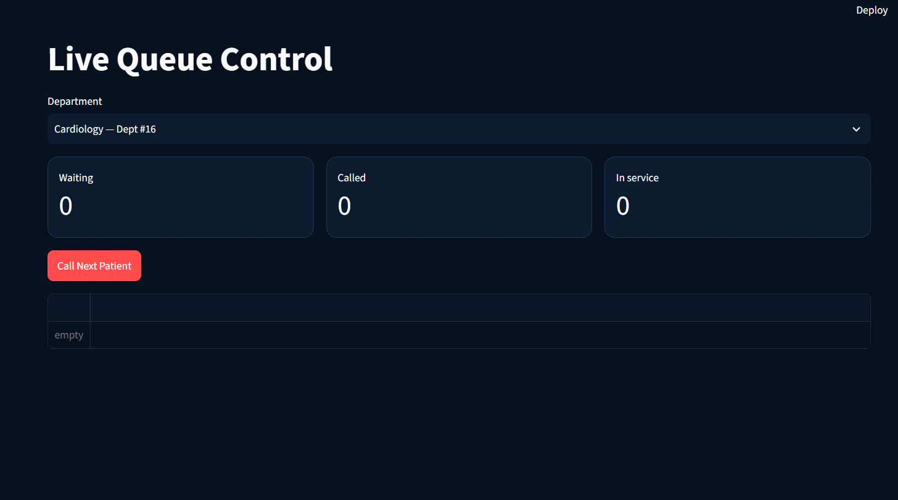

# 🏥 ReferralPath

**A government hospital referral and appointment system:** live doctor availability, capacity-aware booking, automated referral routing and queue management, built on a MySQL database with a Streamlit interface.


## Overview

Bangladesh's public health system is tiered: union health centres, upazila health complexes and district hospitals. When a patient needs a service that their local facility cannot provide, ReferralPath checks live doctor attendance and remaining department capacity at the next facilities in the hierarchy, then routes the referral to a suitable one. It also handles appointment booking and the day-to-day patient queue.

This is a DBMS lab final project. Most of the logic lives in the database (constraints, views and stored procedures); the Streamlit app is a thin interface on top of it.

## Features

| Page | What it does |
|---|---|
| **Overview** | Facility, department, doctor and queue totals; appointment-status and referral-status charts; facility operations table |
| **Patient** | Appointments, queue status and referral history for a selected patient |
| **Appointments** | Book by department, slot and doctor; shows remaining capacity for today; for today's bookings only doctors currently marked present are offered |
| **Referrals** | Check live referral options for a patient and specialty (available doctors, remaining capacity, attendance freshness, hierarchy priority), then route automatically |
| **Queue** | Call the next patient, start service and complete the visit for a department |
| **Attendance** | Record doctor `PUNCH_IN` / `PUNCH_OUT` events and view current attendance status and freshness |
| **Admin** | Facility-level and department-level live status with charts |

## How it works



- **Reads** go through views such as `v_admin_dashboard` and `v_today_queue`, plus a few lookup queries on base tables.
- **Writes** go only through stored procedures (`sp_book_appointment`, `sp_route_referral`, `sp_call_next_patient`, and others), so business rules are enforced in one place, inside the database.
- **Integrity** is enforced by 31 foreign keys, `CHECK` constraints, unique keys and `ENUM` status columns.

Full schema reference: [docs/DATABASE.md](docs/DATABASE.md). Entity-relationship diagram: [docs/ERD.md](docs/ERD.md).

## Tech stack

| Layer | Technology |
|---|---|
| Interface | Streamlit, Plotly |
| Data access | mysql-connector-python, pandas |
| Database | MySQL 8.0 (tables, views, stored procedures) |

## Quick start

**Requirements:** Python 3.10+ (developed on 3.13), MySQL 8.0+, Git.

**1. Clone the repository**

```bash
git clone https://github.com/shopu10/ReferralPath.git
cd ReferralPath
```

**2. Create and import the database**

```bash
mysql -u root -p -e "CREATE DATABASE referralpath CHARACTER SET utf8mb4;"
mysql -u root -p referralpath < database/referral_path.sql
```

If the `mysql` command is not on your PATH, use MySQL Workbench instead: **Server > Data Import > Import from Self-Contained File**, with `referralpath` as the target schema. Import as the `root` user. More detail in [database/README.md](database/README.md).

**3. Install dependencies**

```bash
python -m venv .venv
.venv\Scripts\activate        # Windows
# source .venv/bin/activate   # macOS / Linux
pip install -r requirements.txt
```

**4. Run the app**

```bash
python -m streamlit run streamlit_app.py
```

On Windows you can also double-click `run_referralpath.bat`. The app opens at http://localhost:8501.

**5. Connect to MySQL**

In the sidebar enter Host `127.0.0.1`, Port `3306`, User `root`, Database `referralpath` and your MySQL password, then click **Connect**. No `.env` file is needed: the password is typed at runtime and never stored.

## Sample data

The included dump contains fictional demo data: 2 districts, 4 upazilas, 8 facilities (2 union, 2 upazila and 4 district-level), 19 departments across 6 specialties, 12 doctors, 15 patients, 18 appointments and 3 referrals.

Several views are computed relative to the current date and time (today's queue, live capacity, attendance freshness). The sample appointments and attendance were created in September 2026, so on other dates some of those panels may look empty or stale until you book an appointment or record an attendance punch for today.

## Project structure

```
ReferralPath/
├── streamlit_app.py        # Streamlit application
├── requirements.txt        # Python dependencies
├── run_referralpath.bat    # Windows launcher
├── .streamlit/
│   └── config.toml         # Theme and app settings
├── database/
│   ├── referral_path.sql   # Schema, views, stored procedures, sample data
│   └── README.md           # Import and export instructions
├── docs/
│   ├── DATABASE.md         # Schema reference
│   ├── ERD.md              # Entity-relationship diagram
│   └── screenshots/        # Images used in this README
├── LICENSE
└── README.md
```

## Screenshots

| Overview | Appointments |
|---|---|
|  |  |

| Referrals | Queue |
|---|---|
|  |  |

## Limitations

- Built for local, single-user use: there is no login or role-based access control.
- Demo data is fictional; do not load real patient information.
- The application is a single Python file, written for a course project rather than as production software.

## License

Released under the [MIT License](LICENSE).

## Author

Built by [shopu10](https://github.com/shopu10).
