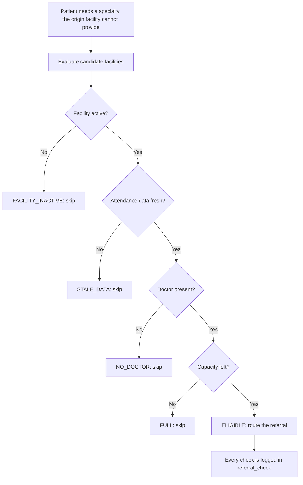
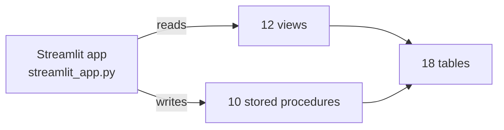

# 🏥 ReferralPath

**Referral routing that checks a doctor is actually there before it sends a patient.**

ReferralPath is a referral and appointment system for a tiered public health service (union, upazila and district facilities). Before a patient is referred, it checks live doctor attendance and remaining capacity at the candidate facilities, and it refuses to trust attendance data that has gone stale. Built on MySQL stored procedures with a Streamlit interface.


## The problem

A referral is only useful if the receiving facility can actually see the patient: a doctor for that specialty has to be on duty, and the department has to have capacity left. A referral letter can't tell you either, so a patient can be sent on to a clinic with nobody there to treat them.

ReferralPath makes that check part of the referral itself.

## What makes it different

- **Attendance-aware.** A doctor counts as present only if their last valid punch is a `PUNCH_IN` within the facility's freshness window (120 minutes by default, configurable per attendance source).
- **Won't trust stale data.** If a facility's attendance feed is older than its window, the facility is marked `STALE_DATA` and is not eligible. "Unknown" is treated differently from "available".
- **Capacity-aware.** A department must have appointment capacity left for the day, not just a doctor on duty.
- **Explainable.** Every facility evaluated for a referral is recorded in `referral_check` with the doctor-availability result, capacity status, attendance freshness, a reason, and whether it was selected.
- **Rules live in the database.** Views, stored procedures and constraints enforce the logic, so every client gets the same behaviour. The Streamlit app is a thin interface on top.

## How a referral is decided



| Result | Meaning |
|---|---|
| `ELIGIBLE` | A department for the requested specialty has a doctor present, capacity left and fresh attendance data |
| `NO_DOCTOR` | No doctor is currently marked present |
| `FULL` | Doctors are present but the department has no remaining capacity |
| `STALE_DATA` | The facility's attendance data is older than its freshness window |
| `FACILITY_INACTIVE` | The facility is switched off |
| `UNAVAILABLE` | The department is unavailable for another reason |

## Features

| Page | What it does |
|---|---|
| **Overview** | Facility, department, doctor and queue totals; appointment-status and referral-status charts; facility operations table |
| **Patient** | Appointments, queue status and referral history for a selected patient |
| **Appointments** | Book by department, slot and doctor; shows remaining capacity for today; for today's bookings only doctors currently marked present are offered |
| **Referrals** | The "Smart Referral Engine": check live options for a patient and specialty (available doctors, remaining capacity, attendance freshness, facility level and hierarchy priority), then run automatic routing |
| **Queue** | Call the next patient, start service and complete the visit for a department |
| **Attendance** | Record doctor `PUNCH_IN` / `PUNCH_OUT` events and view current attendance status and freshness |
| **Admin** | Facility-level and department-level live status with charts |

## Screenshots

| Overview | Appointments |
|---|---|
|  |  |

| Referrals | Queue |
|---|---|
|  |  |

## Architecture



- **Reads** go through views such as `v_referral_candidate_status` and `v_today_queue`, plus a few lookup queries on base tables.
- **Writes** go only through stored procedures (`sp_route_referral`, `sp_book_appointment`, `sp_call_next_patient` and others), so business rules are enforced in one place, inside the database.
- **Integrity** is enforced by 31 foreign keys, `CHECK` constraints, unique keys and `ENUM` status columns.

Full schema reference: [docs/DATABASE.md](docs/DATABASE.md). Entity-relationship diagram: [docs/ERD.md](docs/ERD.md).

## Tech stack

| Layer | Technology |
|---|---|
| Interface | Streamlit, Plotly |
| Data access | mysql-connector-python, pandas |
| Database | MySQL 8.0 (tables, views, stored procedures) |

## Quick start

**Requirements:** Python 3.10+ (developed on 3.13), MySQL 8.0+, Git.

**1. Clone the repository**

```bash
git clone https://github.com/shopu10/ReferralPath.git
cd ReferralPath
```

**2. Create and import the database**

```bash
mysql -u root -p -e "CREATE DATABASE referralpath CHARACTER SET utf8mb4;"
mysql -u root -p referralpath < database/referral_path.sql
```

If the `mysql` command is not on your PATH, use MySQL Workbench instead: **Server > Data Import > Import from Self-Contained File**, with `referralpath` as the target schema. Import as the `root` user. More detail in [database/README.md](database/README.md).

**3. Install dependencies**

```bash
python -m venv .venv
.venv\Scripts\activate        # Windows
# source .venv/bin/activate   # macOS / Linux
pip install -r requirements.txt
```

**4. Run the app**

```bash
python -m streamlit run streamlit_app.py
```

On Windows you can also double-click `run_referralpath.bat`. The app opens at http://localhost:8501.

**5. Connect to MySQL**

In the sidebar enter Host `127.0.0.1`, Port `3306`, User `root`, Database `referralpath` and your MySQL password, then click **Connect**. No `.env` file is needed: the password is typed at runtime and never stored.

## Sample data

The included dump contains fictional demo data: 2 districts, 4 upazilas, 8 facilities (2 union, 2 upazila and 4 district-level), 19 departments across 6 specialties, 12 doctors, 15 patients, 18 appointments and 3 referrals.

Attendance, queue and capacity are computed relative to the current date and time, and the referral decision depends on them. The sample appointments and attendance were created in September 2026, so on other dates the referral check may report `STALE_DATA` or `NO_DOCTOR` until you record fresh attendance punches on the **Attendance** page. That is the staleness rule working as intended, not a bug.

## Project structure

```
ReferralPath/
├── streamlit_app.py        # Streamlit application
├── requirements.txt        # Python dependencies
├── run_referralpath.bat    # Windows launcher
├── .streamlit/
│   └── config.toml         # Theme and app settings
├── database/
│   ├── referral_path.sql   # Schema, views, stored procedures, sample data
│   └── README.md           # Import and export instructions
├── docs/
│   ├── DATABASE.md         # Schema reference
│   ├── ERD.md              # Entity-relationship diagram
│   └── screenshots/        # Images used in this README
├── LICENSE
└── README.md
```

## Limitations

- Built for local, single-user use: there is no login or role-based access control.
- Attendance is entered manually through the app; there is no integration with a real biometric or card system.
- Demo data is fictional; do not load real patient information.
- The application is a single Python file, written for a course project rather than as production software.

## License

Released under the [MIT License](LICENSE).

## Author

Built by [shopu10](https://github.com/shopu10).
